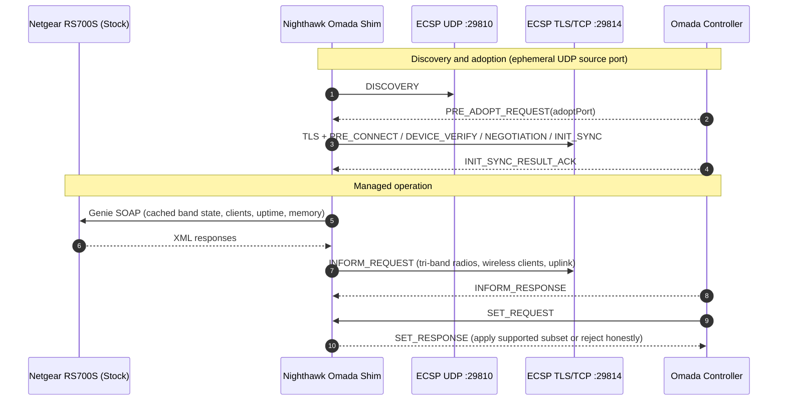

<h1 align="center">Nighthawk Omada Shim</h1>

<p align="center">
  <strong>Connect stock-firmware Netgear Nighthawk access points to a TP-Link Omada controller over ECSP.</strong><br>
  A Python sidecar and container image that adopts Netgear RS700/RS700S routers as native tri-band EAPs in Omada 6.3+.
</p>

<p align="center">
  <a href="https://github.com/spencernorton/nighthawk-omada-shim/actions/workflows/ci.yml"></a>
  <a href="https://github.com/spencernorton/nighthawk-omada-shim/tags"></a>
  <a href="#install"></a>
  <a href="LICENSE"></a>
  <a href="https://buy.stripe.com/8x26oH2U44f65TRe574wM04"></a>
</p>

Nighthawk Omada Shim is an independent sidecar daemon that speaks the TP-Link
Omada ECSP V2 device-management protocol northbound and Netgear's stock Genie
SOAP interface southbound, allowing standalone Netgear Nighthawk RS700/RS700S
access points to appear and report alongside Omada switches and gateways without
flashing third-party firmware. Derived from
[Open Omada Device Agent](https://github.com/adryanalencar/open-omada-device-agent)
(Apache License 2.0, commit `def9cadf`), it runs as a lightweight Python process
or OCI container beside your Omada controller.

> [!WARNING]
> This project is **alpha software**. It is not affiliated with, endorsed by, or
> sponsored by NETGEAR or TP-Link / Omada. Do not deploy it on production
> networks unless you understand the protocol and operational trade-offs.

## What it does

**Native ECSP adoption and persistence.** Discovers the controller over UDP
`29810` from an ephemeral source port, completes legacy V2 Device Account mutual
verification over TLS `29814`, negotiates a conservative tri-band Wi-Fi 7
`EAP770`/`EAP773` profile, and persists non-secret reconnect metadata so
container restarts recover without re-adoption.

**Stock-firmware Netgear RS700/RS700S telemetry.** Queries Netgear Genie SOAP
over HTTPS with bounded fresh and stale-on-error caching to report per-band
2.4/5/6 GHz radio state, router uptime, real used memory
(`100 - NewMemoryUtilization`, never host container metrics), and attributable
wireless clients with negotiated PHY link speeds and approximate signal levels.

**Multi-AP station ownership and honest reconciliation.** When multiple
standalone Nighthawk APs share a site, setting `OMADA_NETGEAR_PHYSICAL_MAC`
restricts each shim to stations whose `ConnAPMAC` confirms local association and
excludes wired pass-through clients so they stay attached to their Omada switch
port. Supported numeric channel writes are applied; unsupported Omada `SET`
requests (including explicit per-SSID VLANs, dynamic VLAN, captive portal,
RADIUS, mesh, and fixed-to-Auto channel changes) are explicitly rejected rather
than fake-applied.

**Optional radio, uplink, and dashboard observers.** Supports an optional
certificate-pinned HTTPS reader for the stock router status pages (primary
auto-selected channels and negotiated Ethernet link speed/duplex), one or two
independent passive 802.11 BSS Load beacon observers
(`scripts/rs700_beacon_observer.py`), and an optional dedicated Omada switch
port byte-counter observer (`scripts/observe-omada-uplink.py`) for measured
AP-wide RX/TX traffic rates.

## Supported features and honest limits

| Area | Status | Notes |
| --- | --- | --- |
| ECSP discovery, adoption, reconnect, rediscovery | Working | Tested against Omada Network Application 6.2 and 6.3 |
| Tri-band EAP770 / EAP773 negotiation | Working | Conservative caps: 1 main SSID; MLO, mesh, DFS, roaming, cluster off |
| Per-band wireless client attribution | Working | Excludes wired pass-through and unattributable rows; multi-AP `ConnAPMAC` ownership |
| Router uptime and used memory | Working | `GetSysUpTime` and `100 - NewMemoryUtilization`; omits `cpuUti` (load avg, not %) |
| Stock dashboard channels and link speed | Optional | Certificate-pinned HTTPS (`OMADA_NETGEAR_DASHBOARD_CERT_SHA256`) |
| Passive 802.11 BSS Load airtime | Optional | One or two independent receivers via `scripts/rs700_beacon_observer.py` |
| Dedicated switch-port uplink rates | Optional | Verified Omada switch octets via `scripts/observe-omada-uplink.py` |
| Numeric channel updates from Omada | Working | Fixed-to-Auto is rejected; Auto-to-Auto is an idempotent no-op |
| Per-SSID VLANs (including explicit VLAN 1) | Rejected | Stock RS700S AP mode does not expose per-SSID VLAN tagging |
| PSK rotation / SSID rename via SOAP | Rejected | Stock firmware returns SOAP `402`; change SSID/PSK in the Netgear UI |
| Captive portal, RADIUS, mesh, LEDs, client block | Rejected | Not supported on stock Netgear southbound |

## Protocol at a glance



## Install

### Docker — Docker Compose

Copy [`docker-compose.example.yml`](docker-compose.example.yml), set your
controller IDs, router IP, unique locally administered virtual MAC, and secret
environment variables (`OMADA_DEVICE_PASSWORD`, `OMADA_NETGEAR_PASSWORD`), then
start the container:

```bash
cp docker-compose.example.yml docker-compose.yml
docker compose up -d
```

Multi-architecture `linux/amd64` and `linux/arm64` images are published to
`ghcr.io/spencernorton/nighthawk-omada-shim` on every `vX.Y.Z` tag. Pin by
digest (`IMAGE_DIGEST.txt` attached to each GitHub Release) in long-lived
deployments.

### From source

```bash
python3 -m venv .venv
source .venv/bin/activate
python -m pip install --upgrade pip
python -m pip install -e .
cp .env.example .env
```

Edit `.env` with `OMADA_SOUTHBOUND=netgear`, `OMADA_CONTROLLER_HOST`,
`OMADA_CONTROLLER_ID`, `OMADA_SITE_ID`, `OMADA_DEVICE_PASSWORD=change-me`,
`OMADA_NETGEAR_HOST`, and `OMADA_NETGEAR_PASSWORD=change-me`, then start the
agent:

```bash
open-omada-agent --dump-tx
```

To verify container or daemon liveness against the per-device heartbeat:

```bash
open-omada-agent --healthcheck
```

If you plan to run `scripts/observe-omada-uplink.py`, install the optional
controller client extra: `python -m pip install -e '.[uplink]'`.

## Documentation

- [Operations guide](docs/operations.md) — Netgear RS700/RS700S deployment, multi-AP isolation, observers, and rollback
- [Configuration reference](docs/configuration.md) — all `OMADA_*` environment variables and defaults
- [Protocol overview](docs/protocol-overview.md) — ECSP V2 transport and message families
- [ECSP wire format](docs/ecsp-wire-format.md) — 4-byte framing and JSON envelope layout
- [Device lifecycle](docs/device-lifecycle.md) — discovery, adoption, sync, reconnect, and rediscovery
- [Architecture](docs/architecture.md) — bounded contexts, ports, and adapters
- [Protocol support matrix](docs/protocol-status.md) — implemented and deferred ECSP families
- [Research methodology](docs/research-methodology.md) — clean-room protocol documentation rules
- [Development guide](docs/development.md) — local environment, test suite, and linting
- [Changelog](CHANGELOG.md) — release history

## Where your data lives

| Path | Purpose |
| --- | --- |
| `/state/agent-state.json` (or `OMADA_STATE_FILE`) | Persisted non-secret controller routing, site, model, and config-version metadata. Device Account and router passwords are never written here. |
| `/tmp/open-omada-heartbeat-<mac>.json` (or `OMADA_HEARTBEAT_FILE`) | Atomic per-device liveness heartbeat read by `--healthcheck`. |
| `/observations/*.json` (optional, read-only) | External JSON snapshots produced by the optional beacon and uplink observer scripts. |

Nothing leaves your LAN by default; an external public-IP lookup runs only if
you explicitly set `OMADA_DEVICE_IP=auto`.

## Contributing and support

- Bugs and feature requests: [open an issue](https://github.com/spencernorton/nighthawk-omada-shim/issues/new/choose). Questions: [Discussions](https://github.com/spencernorton/nighthawk-omada-shim/discussions).
- Security reports: [private vulnerability reporting](https://github.com/spencernorton/nighthawk-omada-shim/security/advisories/new) — see [SECURITY.md](SECURITY.md). There is no e-mail address; that is deliberate.
- Pull requests are reviewed and squash-merged here; read [CONTRIBUTING.md](CONTRIBUTING.md) first.
- If Nighthawk Omada Shim saves you time, you can [support its development](https://buy.stripe.com/8x26oH2U44f65TRe574wM04).

## Development

```bash
python -m compileall -q src tests agent.py
pytest -q
ruff check .
```

## Licence

[Apache License 2.0](LICENSE) © Spencer Norton.

Derived from [Open Omada Device Agent](https://github.com/adryanalencar/open-omada-device-agent)
(© Open Omada contributors, Apache License 2.0, baseline commit
`def9cadf44b60e3aea6afb4a9a3d2c99812288db`). Upstream copyright, disclaimer, and
modification notices are retained in [NOTICE](NOTICE).
